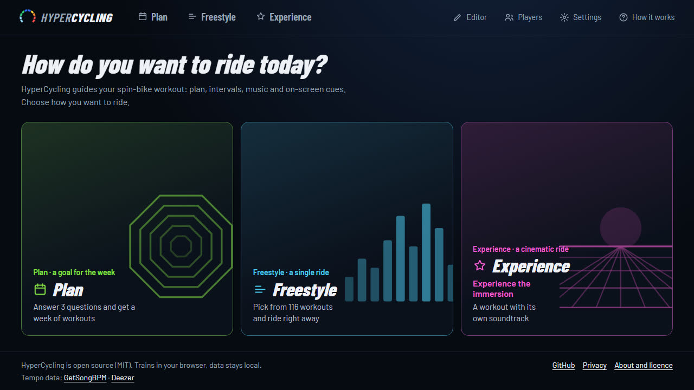
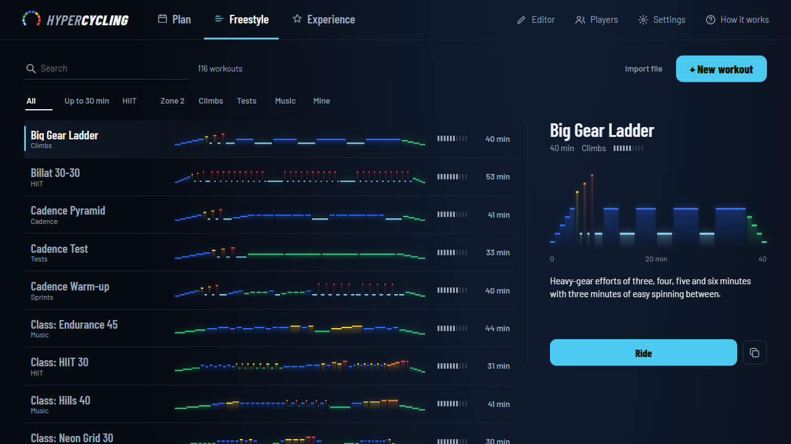
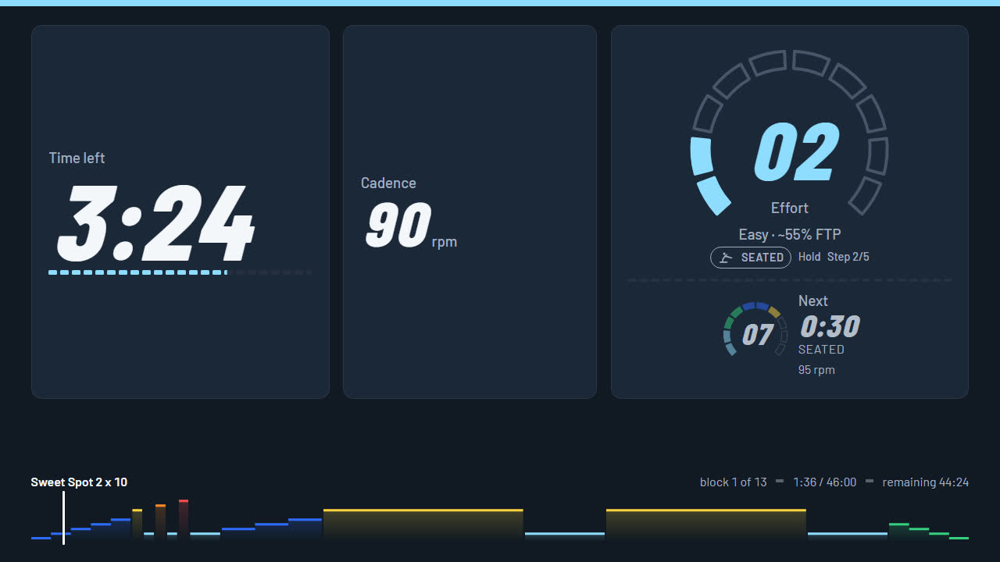
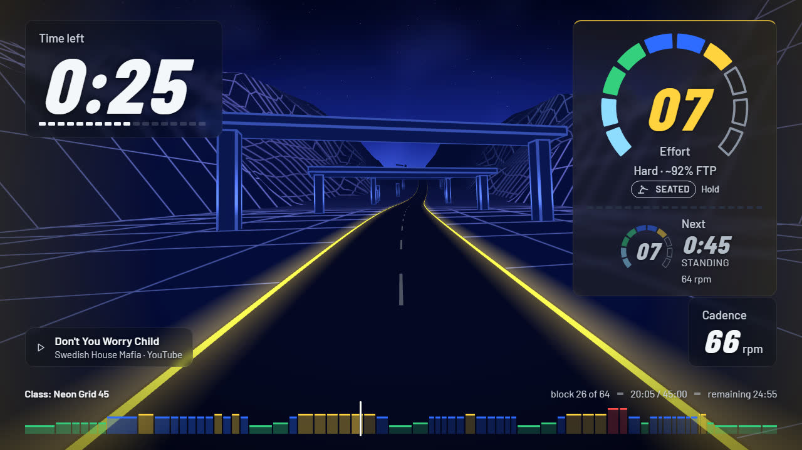
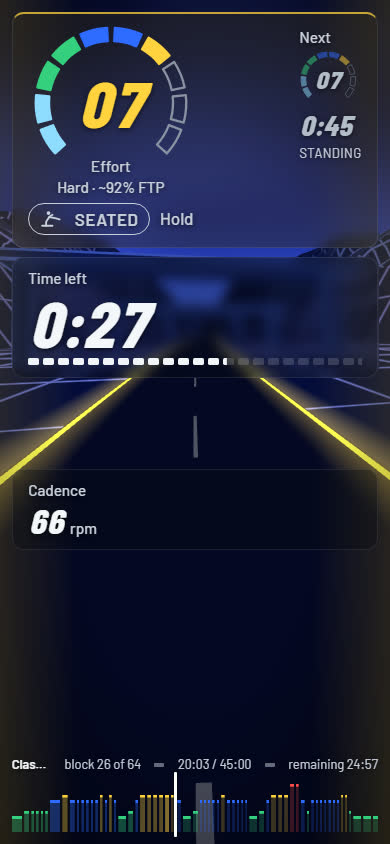

<div align="center">

# HyperCycling

**Indoor cycling in your browser: a plan, on-screen cues and your own music. You pedal, the app does the guiding.**

[](https://github.com/Edios/HyperCycling/actions/workflows/ci.yml)
[](https://github.com/Edios/HyperCycling/actions/workflows/pages.yml)
[](LICENSE)

### [Open the app](https://hypercycling.app/) &nbsp;|&nbsp; [Polski](README.pl.md) &nbsp;|&nbsp; [User guide](docs/user-guide.md)



</div>

HyperCycling is a web app that turns a spin bike or a smart trainer into a guided workout: it shows what to ride, when the next change comes and what to do at it, with music of your choice in the background. No account, no subscription, no install, and no sensors required.

## Three ways to ride

- **Plan.** Answer a few questions (length, difficulty, sessions per week) and get a week of workouts that grows with you.
- **Freestyle.** Pick one of 116 ready workouts, filter or search them, and ride right away.
- **Experience.** A class-style ride with music, chapters and a scene that lights up with the effort. Three Neon Grid rides are included (30 and 45 minutes, plus a lighter 45).

|                                                                                   |                                                                                                     |
| --------------------------------------------------------------------------------- | --------------------------------------------------------------------------------------------------- |
| <br>Freestyle: 116 workouts | <br>Training screen: effort, cadence, next block |
| <br>Experience: Neon Grid 45 | <br>The same ride on a phone       |

## Who it is for

- **Home riders** with a spin bike and a phone, tablet or laptop in front of it, who want to start in a minute.
- **Instructors** who lead a live group and want a screen with blocks, cues and music that follows the plan.
- **Small studios and gyms** that share one screen between a few riders (up to 10 riders, each with a target).

## Features

- **Effort 1-10, not watts.** Ride by a simple scale; add your FTP only if you want target watts. Watts appear only for bikes that measure them.
- **Bikes.** Choose a manual knob, a spin bike with a power meter or a smart trainer; the app adapts its cues. It does not connect to sensors: you describe the bike once.
- **Coach cues.** On-screen commands before each change: add resistance, stand up, sit down.
- **Editor.** Build a workout from blocks, or import `.zwo`, `.erg` and `.mrc` files (see [Importing workouts](docs/importing-workouts.md)).
- **Music.** Pin tracks from YouTube or Spotify to blocks; music failures never pause the workout. No music is bundled. See [Spotify setup](docs/spotify-setup.md).
- **Song finder.** Look up a song's tempo by artist and title (Deezer, GetSongBPM) or type it in.
- **Heart-rate zones.** Enter your max heart rate to see a bpm band next to each effort. A heart-rate monitor is not read.
- **Lite mode.** A plain screen with the same workout and music, for a weak device.
- **Local data, no backend.** Everything stays in your browser (IndexedDB) or, in the local build, in a file on your computer. No account, no analytics. See [Privacy](docs/privacy.md).
- **PL and EN.** The interface is available in Polish and English, with a light and a dark theme.

## Run it

- **In the browser:** https://hypercycling.app/ (best on 1920x1080, works on a phone).
- **Locally**, Node 24 or newer:

```powershell
npm ci
npm start
```

`npm start` builds the app when needed and opens http://127.0.0.1:5175. Use `127.0.0.1` for Spotify and `localhost` for YouTube (YouTube does not embed on an IP address); on the hosted site both work. Details are in [Spotify setup](docs/spotify-setup.md).

## Development

```powershell
npm ci
npm run dev          # Fastify API on 5175 + Vite on http://127.0.0.1:5173 with hot reload
npm run check        # typecheck + eslint + vitest with coverage
npx playwright install chromium   # first time only
npm run test:e2e     # Playwright; builds both variants and starts its own servers
```

Other scripts: `npm run build:pages` (the static build served at hypercycling.app), `npm run docs:screenshots` (regenerates `docs/images/`), `npm run format:check`. The full list is in `package.json`.

## Repository layout

```
src/domain/    pure TypeScript: schemas, effort scale, session engine, parsers
src/client/    React UI: screens, HUD, editor, i18n, three.js scenes, music, setup
src/content/   built-in workouts, plans and Experiences (original content, JSON)
src/storage/   one repositories contract, three back ends: http, IndexedDB, SQLite
src/server/    Fastify API and static hosting (local build only)
src/shared/    Content Security Policy used by both builds
scripts/       local launcher, screenshots, brand assets, music check
tests/e2e/     Playwright specs
docs/          user guide, privacy, architecture, setup notes, screenshots
.github/       CI, Pages deploy, weekly Experience music check
```

More in [Architecture](docs/architecture.md).

## Contributing

Issues and pull requests are welcome.

- Branch from up-to-date `main`; one pull request per feature or fix. Never commit to `main` directly.
- Commits, pull requests, branch names, code and docs are in English; commit messages are conventional (`feat:`, `fix:`, `docs:`, `test:`, `chore:`).
- Run `npm run check` and `npm run test:e2e` before you push. The `check` job in CI must be green before merge.
- UI text goes through the dictionaries `src/client/i18n/en.ts` and `pl.ts`, which need the same keys.

The full list of rules is in [CONTRIBUTING.md](CONTRIBUTING.md).

## Music and licensing notes

- The code is MIT, see [LICENSE](LICENSE). The name and logo "HyperCycling" are not covered by it; please do not use them for a derived product.
- HyperCycling does not distribute music. Tracks are played by YouTube or Spotify under their own terms, in an embedded player or through your own Spotify account. For use with a group (a studio, a class) check the licensing that applies to you.
- YouTube music plays through an embedded YouTube player that the app keeps off-screen. Please check that this fits YouTube's terms for how you use it. If a video cannot be embedded, the app falls back to the Basic background and the workout goes on.
- Tempo lookups send the artist and title you typed to Deezer or GetSongBPM, only when you use them. See [Privacy](docs/privacy.md).

## Status

HyperCycling is in active development and the web app is live. Next: more Experiences, clearer cues before each change, and riding together with a target per person.

## Docs

[User guide](docs/user-guide.md) | [Importing workouts](docs/importing-workouts.md) | [Spotify setup](docs/spotify-setup.md) | [Privacy](docs/privacy.md) | [Architecture](docs/architecture.md) | [Contributing](CONTRIBUTING.md)
