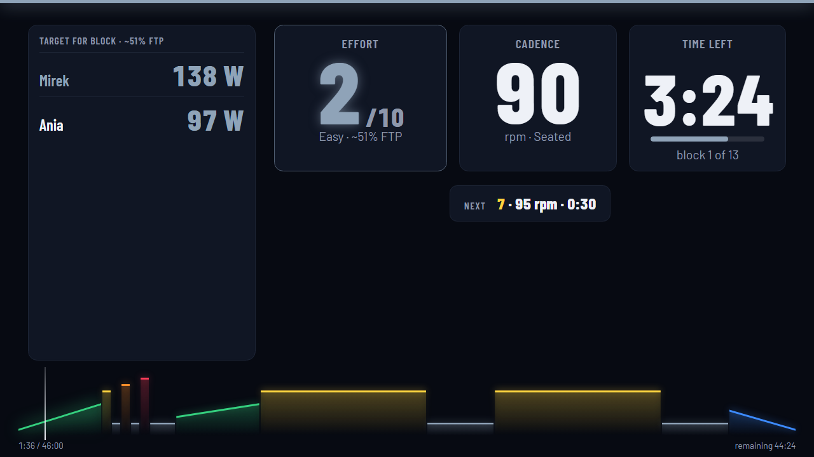

# HyperCycling

Structured indoor-bike workouts, led by your music. Formerly Spinning Tutor.

## Run it

- **In the browser**: https://edios.github.io/HyperCycling/
- **Locally** (Node 24+): `npm ci`, then `npm start`, then open http://127.0.0.1:5175 (use `127.0.0.1`, not `localhost`).

## What it does

- Music-led structured sessions: blocks with beeps and on-screen cues, timed to Spotify or YouTube tracks.
- Effort on a 1-10 scale with configurable zones; add your FTP for target watts. No sensors needed.
- Modes: **Plan** (guided plans with a setup wizard), **Freestyle** (library of about 100 workouts), **World** (3D visual mode); **Coach** is planned.
- FTP test guide, a workout editor, and import of `.zwo`, `.erg`, `.mrc` files.
- Your data stays local: in the browser (IndexedDB) or in a file on your computer.

## Docs

[User guide](docs/user-guide.md) · [Importing workouts](docs/importing-workouts.md) · [Spotify setup](docs/spotify-setup.md) · [Architecture](docs/architecture.md) · [Contributing](CONTRIBUTING.md)

## Licence

MIT, see [LICENSE](LICENSE).
