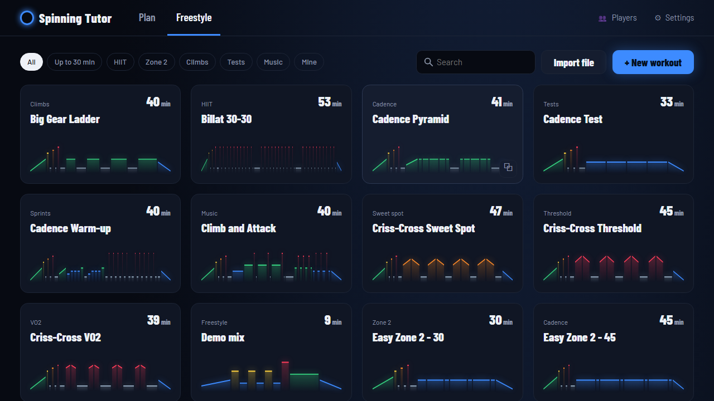
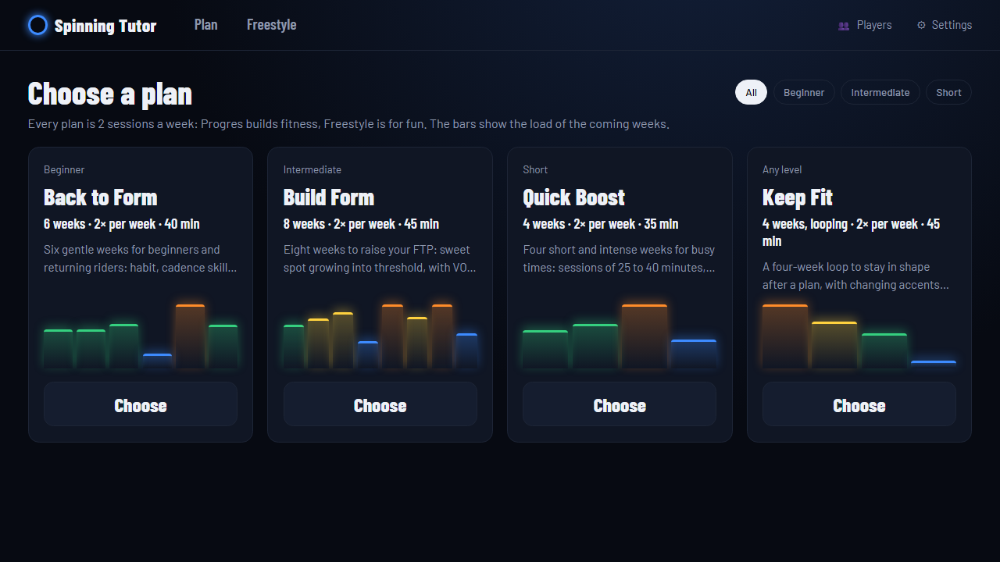
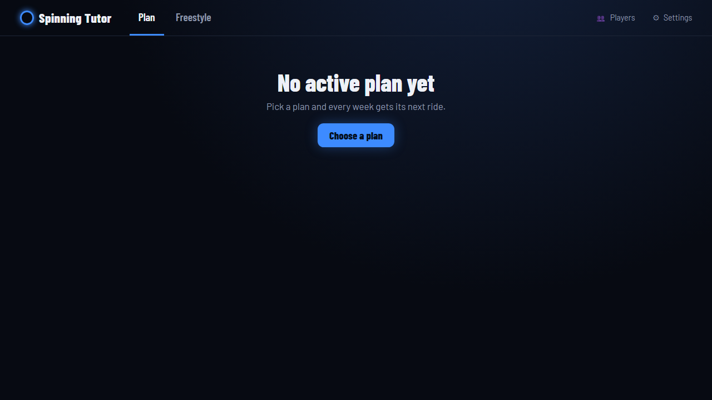
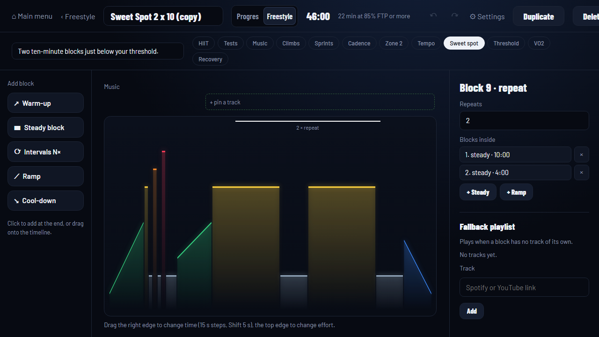
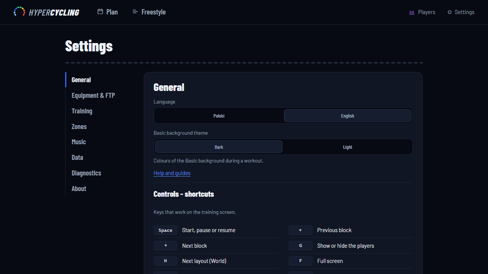

# HyperCycling

**Indoor cycling that rides with your music: effort-guided workouts, plans and an immersive visual mode, right in your browser.**

### [Open the app](https://hypercycling.app/) &nbsp;|&nbsp; [User guide](docs/user-guide.md)

No account, no install, no power meter. Pick a workout, press play, and ride.

## Why HyperCycling

- **No watts needed.** Ride by a simple 1-10 effort scale. Add your FTP only if you want target watts.
- **Your music leads.** Blocks, beeps and on-screen cues are timed to your Spotify or YouTube tracks.
- **Plans that build.** A plan wizard sets length, difficulty and sessions per week; a 20-minute FTP test guide keeps targets honest.
- **Plenty to ride.** About 100 ready workouts, plus an editor and import of `.zwo`, `.erg` and `.mrc` files.
- **Immersive World mode.** A visual 3D ride to keep the minutes moving.
- **Experience: Neon Grid 45.** A class-style ride for your own music: 11 songs, a 5-step resistance knob, 30/30 intervals, hills, sprints, and a grid that brightens with every chapter.
- **Heart-rate zones.** Set your max heart rate and see your zones next to the effort scale.
- **Song finder.** Look up a song's BPM by artist and title (Deezer, GetSongBPM) or enter it by hand.

## A quick tour

|                                                                                                            |                                                                                                    |
| ---------------------------------------------------------------------------------------------------------- | -------------------------------------------------------------------------------------------------- |
|  Training HUD: current block, effort and what is next |  Freestyle: search and filter about 100 workouts |
|  Pick a plan, then tune it in the wizard                   |  Next session and a week-by-week list                         |
|  Build your own workouts or import them                                |  Zones, FTP and players in Settings                        |

## Run it in 30 seconds

- **Browser:** open https://hypercycling.app/ and ride.
- **Locally** (Node 24+): `npm ci`, then `npm start`, then open http://127.0.0.1:5175 (use `127.0.0.1`, not `localhost`, for Spotify). **YouTube music does not play from an IP address** such as `127.0.0.1` (YouTube refuses to embed there): for YouTube locally open http://localhost:5175 instead, or use Spotify. On https://hypercycling.app/ both work.

## Your data stays yours

Local-first: everything lives in your browser (IndexedDB) or in a file on your computer. No account, no analytics, and your heart rate and FTP are never sent anywhere. See [Privacy](docs/privacy.md).

## Personal use

HyperCycling is built for **personal use**. Music plays through Spotify or YouTube under their terms. Playing it for a group (a studio, a class) needs your own venue licence, and any Spotify key or licence is the user's responsibility.

## Roadmap

Done: heart-rate zones, stepped-effort classes, Experience Neon Grid 45, song finder with BPM lookup, mobile readability.

Next:

- More Experiences (shorter and lighter Neon Grid variants, more scenes)
- Clearer cues before each change (10-second heads-up, quiet last minute)
- Riding together: target watts per person
- Later: World v2, LED and room integration

## Docs

[User guide](docs/user-guide.md) | [Importing workouts](docs/importing-workouts.md) | [Spotify setup](docs/spotify-setup.md) | [Privacy](docs/privacy.md) | [Architecture](docs/architecture.md) | [Contributing](CONTRIBUTING.md)

## Licence

MIT, see [LICENSE](LICENSE). The licence covers the code. The name and logo "HyperCycling" are not licensed under MIT: please do not use them for a derived product.
