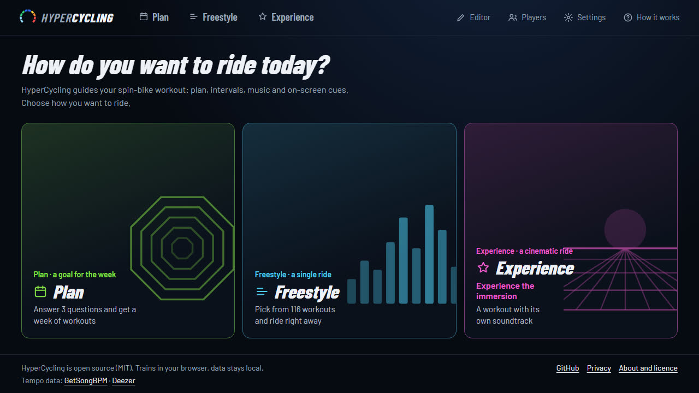
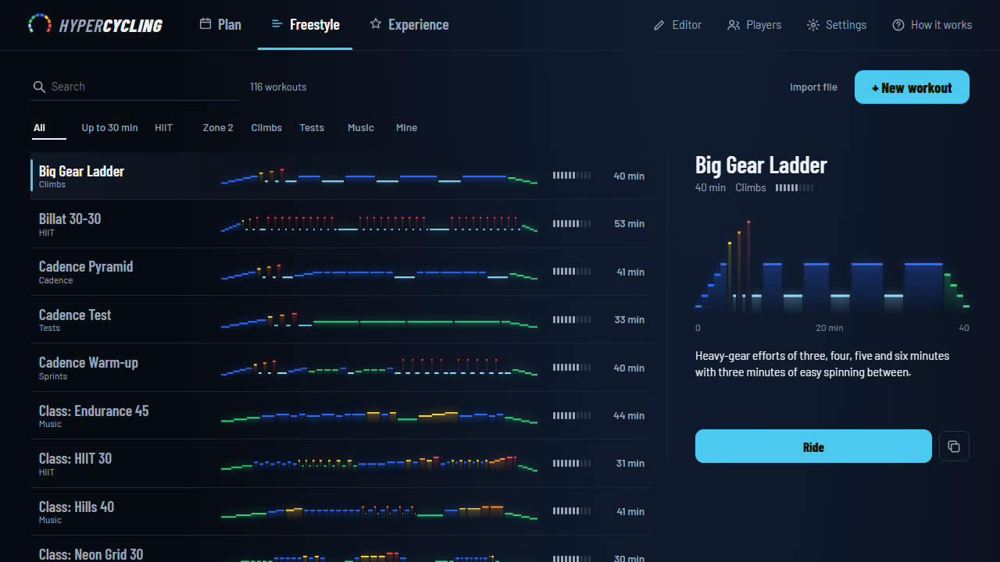
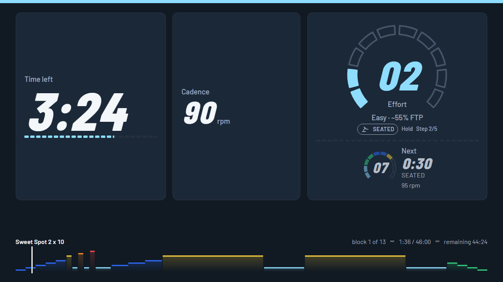
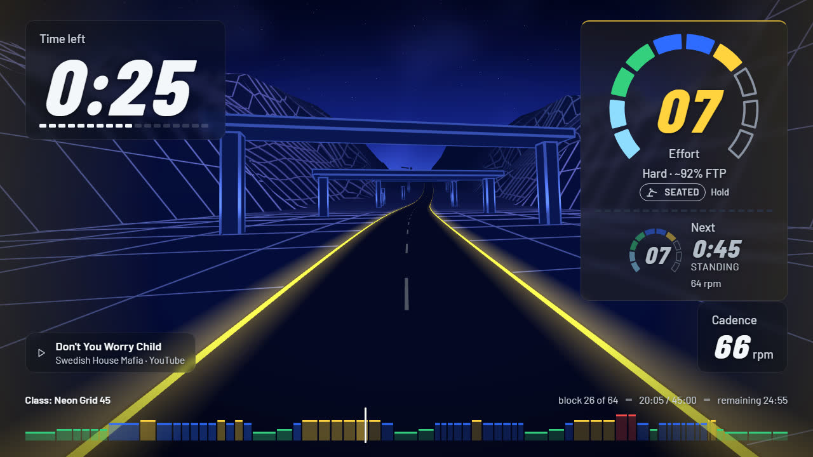
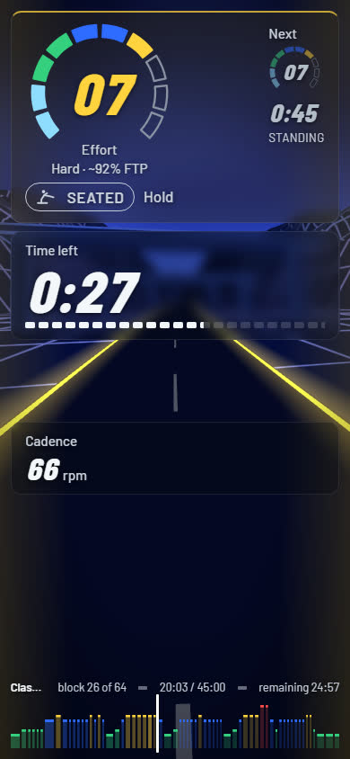

<div align="center">

# HyperCycling

**Trening na rowerze stacjonarnym w przeglądarce: z planem, komendami na ekranie i Twoją muzyką. Ty pedałujesz, resztę prowadzi aplikacja.**

[](https://github.com/Edios/HyperCycling/actions/workflows/ci.yml)
[](https://github.com/Edios/HyperCycling/actions/workflows/pages.yml)
[](LICENSE)

### [Otwórz aplikację](https://hypercycling.app/) &nbsp;|&nbsp; [English](README.md) &nbsp;|&nbsp; [Instrukcja (EN)](docs/user-guide.md)



</div>

HyperCycling to aplikacja webowa, która zamienia rower stacjonarny lub trenażer w prowadzony trening: pokazuje, co jechać, kiedy będzie zmiana i co wtedy zrobić, a w tle gra wybrana przez Ciebie muzyka. Bez konta, bez abonamentu, bez instalacji i bez czujników.

Angielski README jest wersją główną; ta wersja jest jego skróconym tłumaczeniem. Dokumentacja w katalogu `docs/` jest po angielsku, podobnie kod, commity i pull requesty.

## Trzy sposoby jazdy

- **Plan.** Odpowiadasz na kilka pytań (długość, trudność, liczba sesji w tygodniu) i dostajesz tydzień treningów, który rośnie razem z Tobą.
- **Freestyle.** Wybierasz jeden ze 116 gotowych treningów, filtrujesz lub szukasz i jedziesz od razu.
- **Experience.** Jazda w stylu zajęć: muzyka, rozdziały i scena, która rozjaśnia się razem z wysiłkiem. W zestawie trzy jazdy Neon Grid (30 i 45 minut oraz lżejsza 45).

|                                                                                       |                                                                                                        |
| ------------------------------------------------------------------------------------- | ------------------------------------------------------------------------------------------------------ |
| <br>Freestyle: 116 treningów | <br>Ekran treningu: wysiłek, kadencja, następny blok |
| <br>Experience: Neon Grid 45    | <br>Ta sama jazda na telefonie      |

## Dla kogo

- **Domowi rowerzyści** z rowerem stacjonarnym i telefonem, tabletem lub laptopem przed kierownicą, którzy chcą zacząć w minutę.
- **Instruktorzy** prowadzący żywą grupę, którzy potrzebują ekranu z blokami, komendami i muzyką zgodnymi z planem.
- **Małe salki i siłownie**, w których kilka osób dzieli jeden ekran (do 10 osób, każda z własnym celem).

## Funkcje

- **Wysiłek 1-10, nie waty.** Jedziesz według prostej skali; FTP wpisujesz tylko wtedy, gdy chcesz mieć waty docelowe. Waty pojawiają się tylko dla rowerów, które je mierzą.
- **Rowery.** Wybierasz pokrętło, rower z miernikiem mocy albo trenażer; aplikacja dopasowuje komendy. Nie łączy się z czujnikami: raz opisujesz swój rower.
- **Komendy Coacha.** Komunikaty na ekranie przed każdą zmianą: dodaj opór, wstań, usiądź.
- **Edytor.** Układasz trening z bloków albo importujesz pliki `.zwo`, `.erg` i `.mrc` (patrz [Importing workouts](docs/importing-workouts.md)).
- **Muzyka.** Przypinasz utwory z YouTube lub Spotify do bloków; awaria muzyki nigdy nie zatrzymuje treningu. Muzyki nie dołączamy. Patrz [Spotify setup](docs/spotify-setup.md).
- **Wyszukiwarka tempa.** Tempo utworu sprawdzisz po wykonawcy i tytule (Deezer, GetSongBPM) albo wpiszesz ręcznie.
- **Strefy tętna.** Po wpisaniu tętna maksymalnego przy każdym wysiłku widzisz przedział uderzeń na minutę. Pulsometr nie jest odczytywany.
- **Tryb Lite.** Prosty ekran z tym samym treningiem i muzyką, dla słabego urządzenia.
- **Dane lokalnie, bez backendu.** Wszystko zostaje w przeglądarce (IndexedDB) albo, w wersji lokalnej, w pliku na Twoim komputerze. Bez konta, bez analityki. Patrz [Privacy](docs/privacy.md).
- **PL i EN.** Interfejs jest po polsku i po angielsku, w jasnym i ciemnym motywie.

## Uruchomienie

- **W przeglądarce:** https://hypercycling.app/ (najlepiej na 1920x1080, działa też na telefonie).
- **Lokalnie**, Node 24 lub nowszy:

```powershell
npm ci
npm start
```

`npm start` buduje aplikację, gdy trzeba, i otwiera http://127.0.0.1:5175. Dla Spotify używaj `127.0.0.1`, dla YouTube `localhost` (YouTube nie osadza filmów na adresie IP); na hostowanej stronie działają oba. Szczegóły w [Spotify setup](docs/spotify-setup.md).

## Dla deweloperów

```powershell
npm ci
npm run dev          # API Fastify na 5175 + Vite na http://127.0.0.1:5173 z hot reload
npm run check        # typecheck + eslint + vitest z pokryciem
npx playwright install chromium   # tylko za pierwszym razem
npm run test:e2e     # Playwright; buduje oba warianty i uruchamia własne serwery
```

Inne skrypty: `npm run build:pages` (statyczna wersja z hypercycling.app), `npm run docs:screenshots` (odtwarza `docs/images/`), `npm run format:check`. Pełna lista w `package.json`.

## Struktura repozytorium

```
src/domain/    czysty TypeScript: schematy, skala wysiłku, silnik sesji, parsery
src/client/    interfejs React: ekrany, HUD, edytor, i18n, sceny three.js, muzyka, setup
src/content/   wbudowane treningi, plany i Experience (własna treść, JSON)
src/storage/   jeden kontrakt repozytoriów, trzy implementacje: http, IndexedDB, SQLite
src/server/    API Fastify i hosting statyczny (tylko wersja lokalna)
src/shared/    polityka Content Security Policy dla obu wersji
scripts/       lokalny launcher, zrzuty ekranu, zasoby marki, test muzyki
tests/e2e/     testy Playwright
docs/          instrukcja, prywatność, architektura, notatki konfiguracji, zrzuty
.github/       CI, wdrożenie na Pages, cotygodniowy test muzyki Experience
```

Więcej w [Architecture](docs/architecture.md).

## Jak współtworzyć

Zgłoszenia i pull requesty są mile widziane.

- Gałąź z aktualnego `main`; jeden pull request na funkcję lub poprawkę. Nigdy bezpośrednio do `main`.
- Commity, pull requesty, nazwy gałęzi, kod i dokumentacja po angielsku; komunikaty commitów w formacie conventional (`feat:`, `fix:`, `docs:`, `test:`, `chore:`).
- Przed pushem uruchom `npm run check` i `npm run test:e2e`. Zadanie `check` w CI musi być zielone przed scaleniem.
- Teksty interfejsu przechodzą przez słowniki `src/client/i18n/en.ts` i `pl.ts`, które muszą mieć te same klucze.

Pełna lista zasad w [CONTRIBUTING.md](CONTRIBUTING.md).

## Muzyka i licencja

- Kod jest na licencji MIT, patrz [LICENSE](LICENSE). Nazwa i logo "HyperCycling" nie są nią objęte; prosimy nie używać ich w produkcie pochodnym.
- HyperCycling nie rozpowszechnia muzyki. Utwory odtwarzają YouTube i Spotify na swoich zasadach, w osadzonym odtwarzaczu lub przez Twoje konto Spotify. Przy użyciu dla grupy (salka, zajęcia) sprawdź licencje, które Cię dotyczą.
- Muzyka z YouTube gra przez osadzony odtwarzacz YouTube, który aplikacja trzyma poza ekranem. Sprawdź, czy pasuje to do zasad YouTube dla Twojego sposobu użycia. Gdy filmu nie da się osadzić, aplikacja przechodzi na tło Basic, a trening trwa dalej.
- Wyszukiwanie tempa wysyła wpisanego wykonawcę i tytuł do Deezer lub GetSongBPM, tylko gdy z niego korzystasz. Patrz [Privacy](docs/privacy.md).

## Status

HyperCycling jest rozwijany, a aplikacja webowa działa. W planach: kolejne Experience, wyraźniejsze komendy przed każdą zmianą i jazda razem z celem dla każdej osoby.
