# User guide

HyperCycling runs indoor-bike workouts on a screen in front of your bike: effort to ride, cadence, time left and the next block, with optional beeps, cues and music. No sensors needed: pick an effort from 1 to 10 and, if you know your FTP, get target watts.

Two ways to run it, same app:

- **Local**: `npm start` opens `http://127.0.0.1:5175`. Data lives in `data/spinning-tutor.db`, with a backup before each import.
- **Browser**: https://hypercycling.app/. Data lives in the browser (IndexedDB); use Settings, Data to export it.

Best on 1920x1080 (minimum 1280x720).

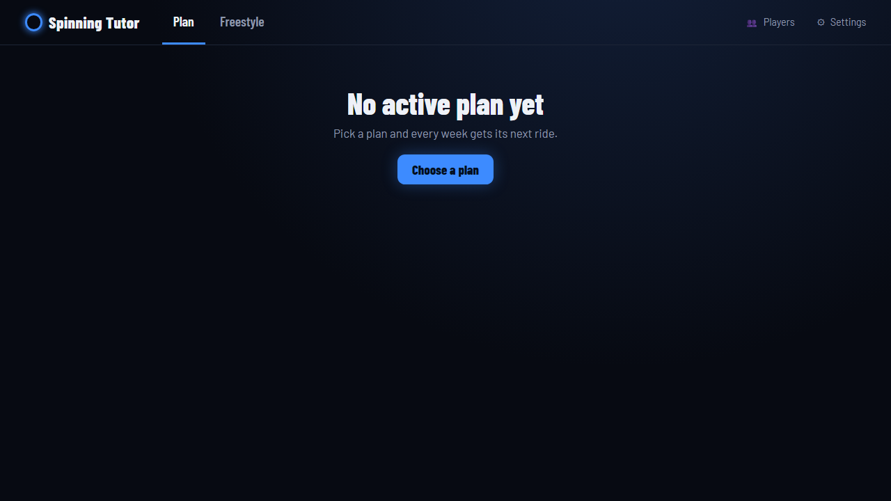

## Modes

The top bar has **Plan**, **Freestyle**, **Players** and **Settings**. **World** is a visual mode you choose on the setup screen. **Coach** is planned, not available yet.

**Plan** is the guided way. Each week has two sessions: **Progres** builds fitness, **Freestyle** is for fun. Built-in plans: Back to Form, Build Form, Keep Fit, Quick Boost. Pick one in **Choose a plan**, then the plan wizard offers:

- session length (stretches warm-up, cool-down and repeats),
- difficulty: easier -5 %, standard, harder +5 %,
- sessions per week: Progres + Freestyle, 2 x Progres, or a third Freestyle,
- start week and your FTP.

The Plan tab shows your next session with **Ride**, **Swap** for an alternative, and a week-by-week list. After a ride you choose whether it counts toward the plan.

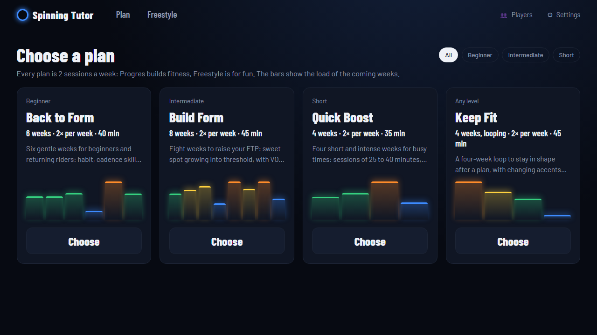

**Freestyle** is the library of single workouts (about 100), with filters (up to 30 min, HIIT, Zone 2, Climbs, Tests, Music, Mine) and search.

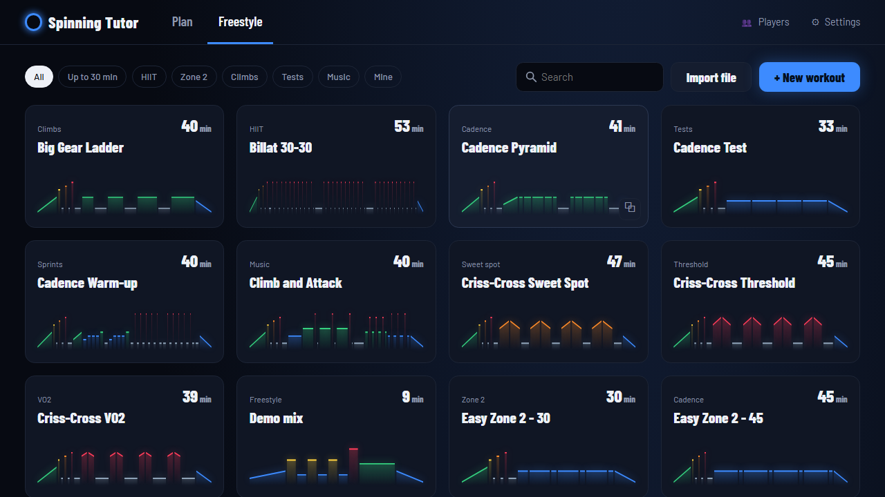

## Setup before a ride

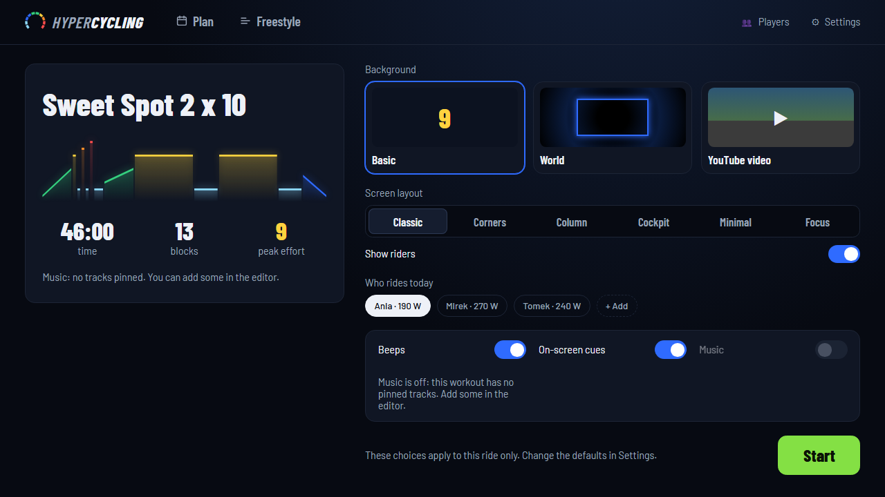

- **Background**: _Basic_ (large numbers on a dark or light panel), _World_ (a 3D scene you ride through; needs WebGL, Settings, Training has a Low quality mode) or _YouTube video_ (paste a watch, youtu.be, Shorts or embed link; start times like `t=1m30s` work). If a video cannot be embedded, Basic is used.
- **Screen layout**: works on every background. _Corners_, _Column_ (panel on the right), _Cockpit_, _Minimal_ (just the time), _Focus_ (clean screen; numbers fade in on mouse, touch or key, around block changes, and during count-in, pause, dialogs and the last 10 seconds). Basic also has _Classic_ (tiled). **Show riders** adds each rider's target watts; it needs a selected rider and is unavailable in Cockpit and Minimal.
- **Who rides today**: up to 10 riders, or add one on the spot. Target watts come from each rider's FTP.
- **Beeps**, **On-screen cues**, **Music** switches. Music is available when the workout has pinned tracks.

Choices here apply to that ride only; defaults are in Settings, Training.

### Players

Name (1-24 characters) and FTP (whole watts, 50-600). Mark one rider **This is me**: that FTP is used in Settings and for FTP test results.

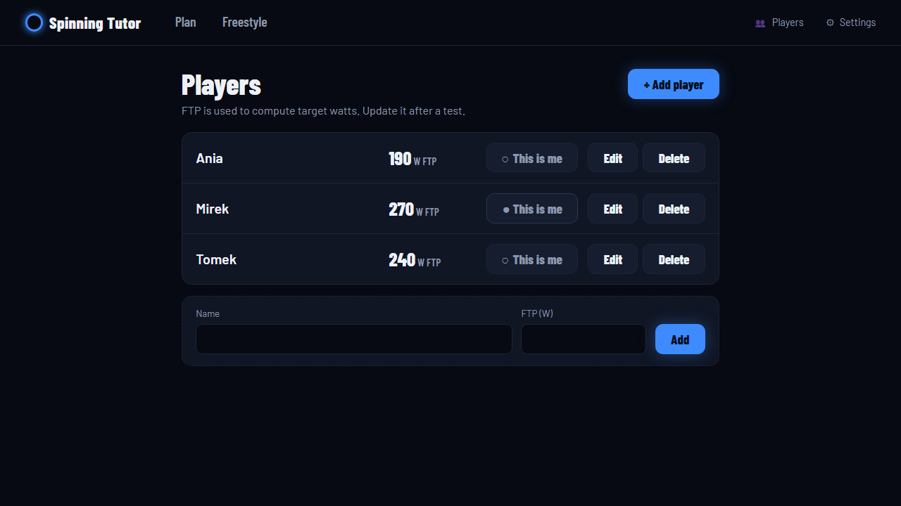

## During a workout

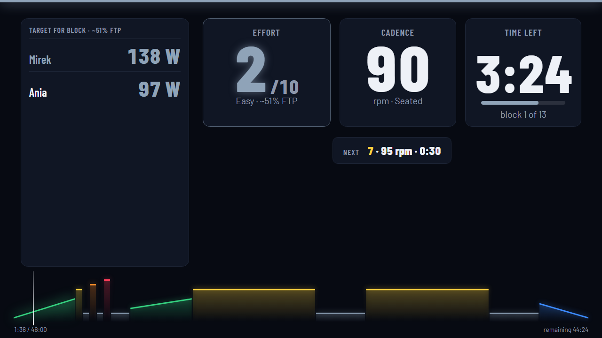

Press **Space** (or **Start**): 3-second countdown, then the workout. The screen shows effort (1-10, label, about % of FTP), cadence, position (seated or standing), time left, the next block and a timeline.

| Key                | Action                                          |
| ------------------ | ----------------------------------------------- |
| Space              | start, pause, resume                            |
| Left / Right arrow | previous / next block                           |
| G                  | show or hide the players list                   |
| H                  | next layout                                     |
| F                  | fullscreen                                      |
| M                  | mute beeps and music                            |
| Esc                | close quick settings, or ask to end the workout |

The control bar hides after a few idle seconds. It repeats the keys, plus **Quick settings** (background, layout, beeps, cues) and **Menu**.

**Ending**: Menu or Esc offers _End and see summary_, _Leave without saving_ or _Cancel_. If the tab closes or the PC sleeps mid-ride, the next start offers **Resume** or **Discard**.

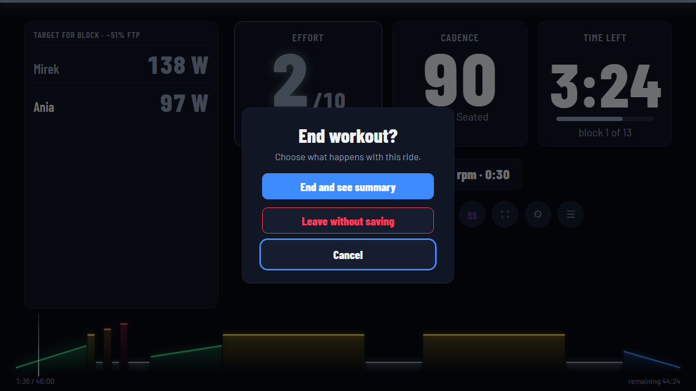

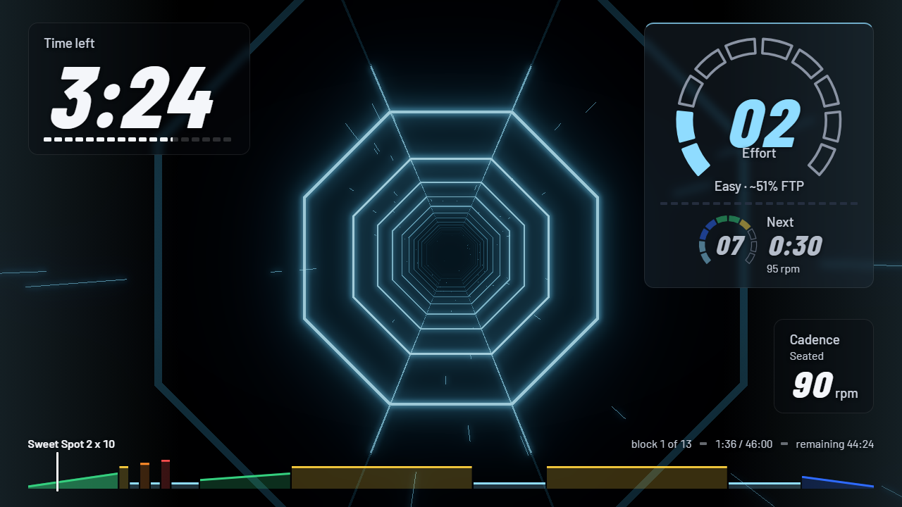

The **summary** shows time ridden and whether you completed the workout. After an FTP test it proposes a new FTP.

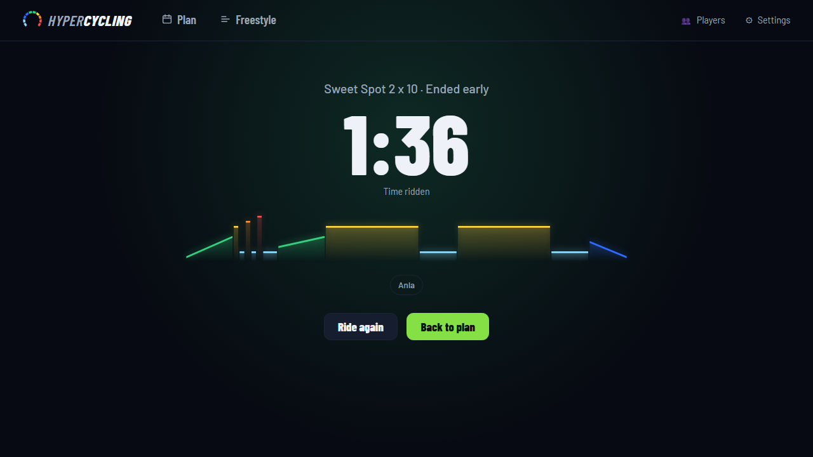

## Settings

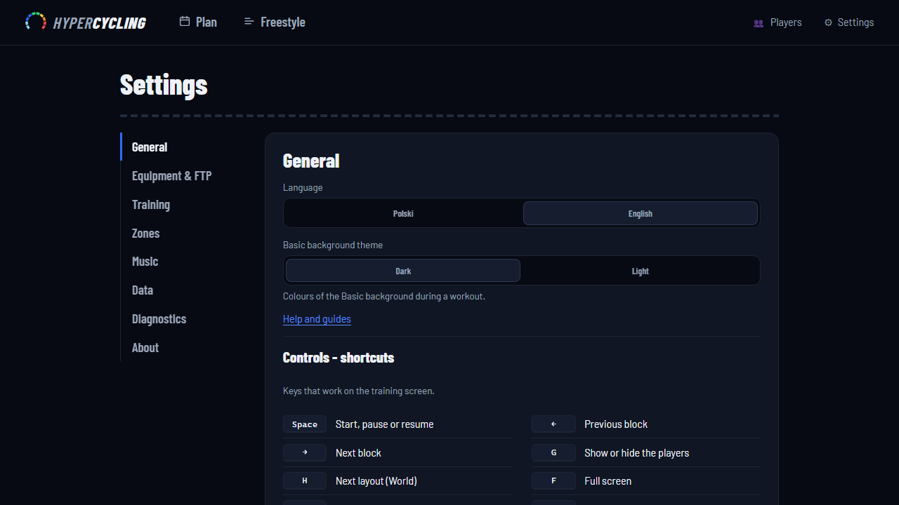

- **General**: language, Basic theme (dark or light), link to this help.
- **Equipment & FTP**: what your bike reports (watts, cadence), your FTP, the FTP test guide.
- **Training**: sounds, coach messages, effects intensity, World quality, default background and layout.
- **Zones**: 10 effort levels, each with a %FTP (20-200, strictly increasing) and a colour; **Restore defaults** resets.
- **Music**: Spotify connection, see [Spotify setup](spotify-setup.md).
- **Data**: export, import, storage location, recent YouTube links.

### FTP test guide

FTP is the power you can hold for about an hour. Pick a test, ride it (**Start this test**), enter the measured power, and the calculator saves your FTP for the rider marked "me".

| Test                     | What to note                          | FTP                            |
| ------------------------ | ------------------------------------- | ------------------------------ |
| Ramp test (about 35 min) | best 1-minute power                   | 75 % of it                     |
| 20-minute test           | average power of the 20 minutes       | 95 % of it                     |
| 2 x 8-minute test        | average power of each 8-minute effort | 90 % of the average of the two |

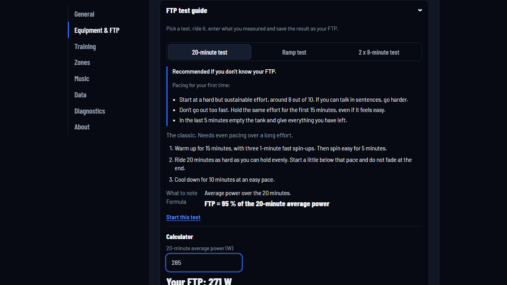

### Data export and import

**Export data** downloads one JSON file with workouts, players, plans, history and settings (Spotify tokens excluded). **Import data** replaces everything with the file's contents, after validation: a file that is not an app export, has a different version or invalid data changes nothing and shows the reason. The local build backs up the database to `data/backups/` first (10 newest kept).

## Editor and importing

**+ New workout** in Freestyle opens the editor. Built-in workouts are read-only: **Duplicate to edit**.

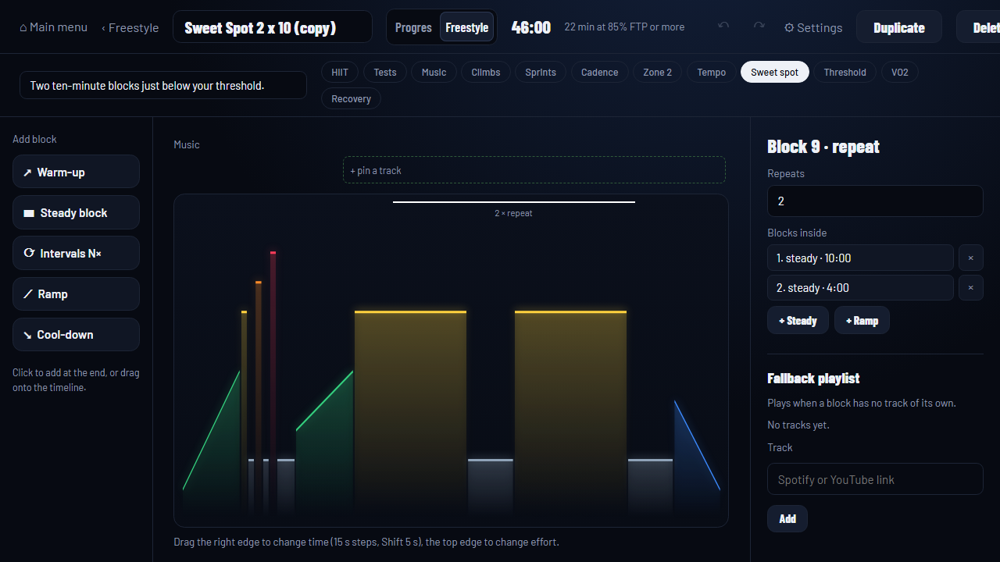

- Add blocks from the palette (warm-up, steady, intervals N x, ramp, cool-down) by click or drag.
- Drag a block's right edge to change its time (15 s steps, Shift for 5 s), its top edge to change effort.
- The inspector sets effort or exact %FTP, time, cadence, seated or standing, an on-screen command and repeats.
- Name, tags, undo and redo, then **Save**.

For `.zwo`, `.erg`, `.mrc` files use **Import file** in Freestyle: see [Importing workouts](importing-workouts.md).

## Music

Pin music to blocks in the editor (a Spotify or YouTube link, optionally with a start time). A **fallback playlist** plays when a block has no track. Turn music on in setup.

- **Spotify**: plays through the Spotify app on your device; needs Premium and an active device. See [Spotify setup](spotify-setup.md).
- **YouTube**: no sign-in, but the video must allow embedding.

A track that cannot play gives one warning; the workout carries on. A YouTube _track_ (audio) is not the YouTube _background_ (video).
